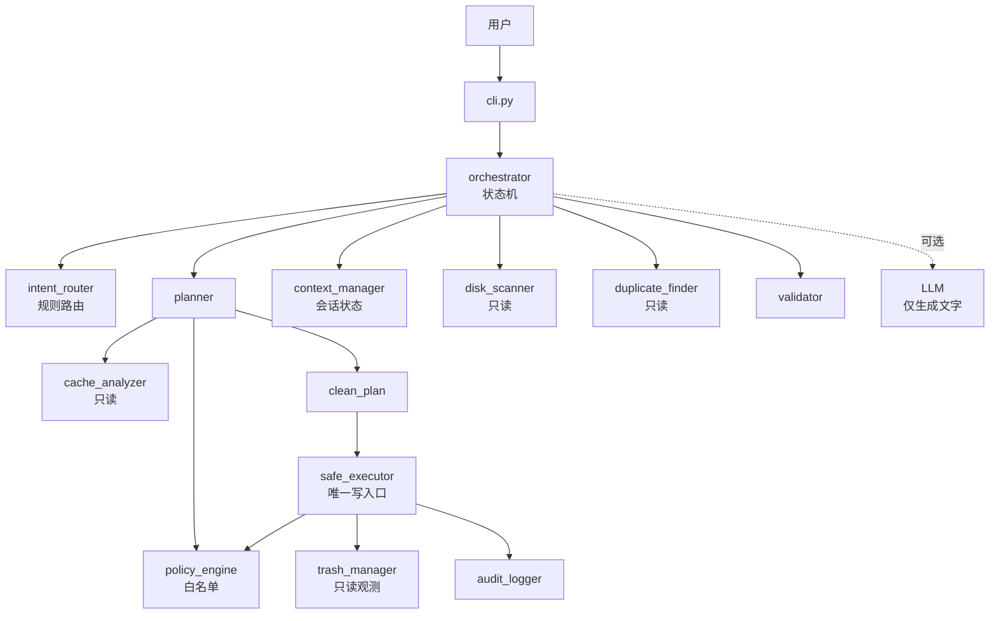

# Disk Doctor Reference

> 一个从**公开可观察行为**反向重建的磁盘健康 Agent，clean-room 独立实现。
> 重点不是"复刻一个产品"，而是回答一个问题：**当安全要求与便利性冲突时，代码该怎么组织？**

[](https://github.com/eli941280-droid/disk-doctor-reference/actions/workflows/ci.yml)

---

## 1. 项目简介

这个项目做三件事：

1. 研究一个商业 AI Expert（WorkBuddy 中的「磁盘医生」）的**外部可观察架构**；
2. 把研究结论转成一个**可运行**的 Python Agent；
3. 把"哪些是复现、哪些是猜的"写在文档里，而不是藏在代码里。

它不是一个清理工具。它是一份**关于如何给 Agent 装安全边界**的可执行论证。

**English.** Disk Doctor Reference is an independent, safety-oriented AI Agent
reference implementation based on observable behavior, deterministic policy
enforcement, and constrained execution. 项目重点研究 Prompt Architecture、
Agent Workflow、Deterministic Decision Engine 和安全执行边界。

**这不是 WorkBuddy「磁盘医生」的官方复制品**：本项目没有获取过它的隐藏提示词、
私有源代码或内部配置；`prompts/` 下的提示词为本项目原创。

**当前状态**：v0.2.3，功能完整，215 个测试通过，1 个跳过（需要 Windows 符号链接权限）。Ruff 零告警。
不声明"生产可用"——见 [已知局限](#10-已知局限)。

**链接**：[Issues](https://github.com/eli941280-droid/disk-doctor-reference/issues)
· [Releases](https://github.com/eli941280-droid/disk-doctor-reference/releases)
· [Contributing](CONTRIBUTING.md)
· [Security](SECURITY.md)
· 许可证：MIT（见 [`LICENSE`](LICENSE)）

---

## 2. 研究动机

大多数 Agent 框架的写法是：写一段提示词，告诉模型"你必须先确认再删除"，然后用工程壳包起来。

这种做法的失效方式很固定：模型偶尔不遵守，而系统没有任何机制发现它没遵守。
更糟的是，用户看到的行为是对的（大部分时候），所以问题被掩盖，直到某次误删。

本项目换了一种组织方式：

> **凡是能用代码断言的，就不写进提示词。**

于是有了这条测试：

```python
def test_model_has_no_write_tools(agent):
    assert agent.capabilities()["write_tools"] == []
```

模型可见的工具注册表里**一个写工具都没有**——不是"把开关关掉了"，而是没有对应的
注册表 API：`ToolRegistry(llm_facing=True)` 在 `register(read_only=False)` 时直接抛错。

`SafeExecutor` 仍是应用架构层唯一的用户文件写入入口，但它由 Agent 的固定执行流程
（`execute_plan`）调用，**不注册成 LLM 可调用的工具**。所以"模型建议删点什么"
这件事，在结构上到不了文件系统。

这个限定的范围要说清楚：它是**应用架构层**的边界。同进程的代码可以直接拿到 backend
对象——Python 的私有方法不是安全沙箱，本项目不声称能抵御同进程恶意代码。

---

## 3. 核心功能

| 能力 | 说明 | 是否写盘 |
|------|------|---------|
| 磁盘诊断 | 用量、健康评分、目录体积、大文件 Top N | ❌ |
| 缓存识别 | 按签名识别已知缓存目录，估算可释放空间 | ❌ |
| 重复文件检测 | 大小预筛 → 64 KiB 哈希 → 全量 SHA-256 | ❌ |
| 清理计划 | 生成结构化 `CleanPlan`（文件级），含被拦截项与 SHA-256 摘要 | ❌ |
| 安全执行 | 移入回收站（或本地隔离区） | ✅ **唯一写入口** |
| 结果核对 | 重新检查路径，区分实测与估算 | ❌ |
| 成就统计 | 累计释放量、里程碑 | 仅自身统计文件 |

---

## 4. 架构



详细视图见 [`docs/system_architecture.md`](docs/system_architecture.md)。

### 四条不可绕过的边界

```
1. 只处理 --allow-root 授权范围
2. 计划必须落盘，执行必须回填完整 64 位 plan_id
3. 同一计划同一时刻只允许一个执行者（跨进程锁）
4. 回收站不可用 → 整体阻断，不退化为永久删除
```

`--yes` 不能表达"批准了哪一份文件清单"，v0.2.1 起已从执行路径移除；
v0.2.2 进一步把执行收敛为**唯一入口**：模型可见的工具列表里没有任何写操作。

---

## 5. 技术原理

### 5.1 计划是唯一载体

```
候选 → CleanPlan → 预览文本
            ↓
        执行结果 → 对账
```

报告、执行、校验全部读同一个 `CleanPlan`。所以"预览说 8.3 GB、报告说 7.8 GB"这种矛盾不会发生——
它们根本没机会各算各的。

### 5.2 读写权限分离

| 模块 | 权限 |
|------|------|
| disk_scanner / cache_analyzer / duplicate_finder | 只读 |
| plan_builder | 纯数据变换 |
| trash_manager | 只读观测（v0.2.2 移除了 `move()`） |
| tool_registry | 只读视图（拒绝注册写工具） |
| safe_executor | **唯一写入口** |

产品的界面标了 6 个技能。照抄那 6 个名字会得到 6 个模块，其中若干既能发现又能删除。
本项目把 `cache-cleaner` 降级为只读：**发现与执行拆开，预览才成为结构性保证，而不是纪律要求。**

### 5.3 确认绑定到 plan_id，且只能消费一次

```
用户请求
  ↓
agent.handle()                     只读扫描 + 生成计划
  ↓
生成并保存 CleanPlan               ← 预览阶段就已持久化
  ↓
PlanStore.load(plan_id)            ← 执行时加载原计划，不重新生成
  ↓
展示完整文件清单
  ↓
用户输入完整 EXECUTE <plan_id>
  ↓
ConfirmationAuthority.issue()      ← 一次性凭证：HMAC + nonce + 5 分钟有效期
  ↓
PlanStore.claim_for_execution()    ← 跨进程锁 + 写 IN_PROGRESS
  ↓
SafeExecutor.execute()             ← 原子消费凭证，逐文件复检后移动
  ↓
验证结果
```

七条要点：

1. 计划在**预览阶段**就写入 `PlanStore`，不是确认后才生成。
2. 确认绑定**完整 64 位 plan_id**；`yes` 不构成确认，它无法表达批准了哪一份清单。
3. 执行阶段用 `load(plan_id)` 取回原计划，**不重新扫描、不重新生成**。
4. 计划内容一变，SHA-256 摘要就变，旧 plan_id 与旧确认同时失效。
5. 同一计划只能被 `claim_for_execution()` 领取一次；并发的第二个请求得到 `plan_locked`。
6. 文件数 > 50 或总量 > 1 GiB 时，还要输入 `SECOND <plan_id>`。
7. 进程中断留下的 `IN_PROGRESS` 计划会被标记为 `INTERRUPTED`，**不能自动重放**——
   只能重新扫描、重新生成、重新确认。

### 5.4 符号链接在解析之前拦截

```
1. 是链接？        → 拒（symlink_denied）
2. 解析后越界？    → 拒（escape_via_link）
3. 复检再比对一次  → 防 TOCTOU
```

先解析再判断会抹掉"这是链接"这个事实，既无法解释拒绝原因，也让白名单可被一个 `ln -s` 绕过。

---

## 6. 安装

```bash
git clone https://github.com/eli941280-droid/disk-doctor-reference.git
cd disk-doctor-reference
```

**方式一：Conda（推荐，`environment.yml`）**

```bash
conda env create --file environment.yml
conda activate disk-doctor-reference
pip install -e ".[dev,llm]"
```

**方式二：venv**

```bash
python -m venv .venv
# Windows
.venv\Scripts\activate
# macOS / Linux
source .venv/bin/activate
pip install -e ".[dev,llm]"
```

要求 Python ≥ 3.11（CI 覆盖 3.11 / 3.12 / 3.13）。

---

## 7. 使用

### 7.1 Mock 模式（无需 API Key）

```bash
python examples/mock_demo.py
```

在临时沙箱里跑完整链路：诊断 → 计划 → 拦截 → 执行 → 核对 → 成就。退出时自动清理，不碰真实磁盘。

### 7.2 配置模型（可选）

```bash
cp .env.example .env
# 编辑 .env，填入 DISK_DOCTOR_API_KEY
```

默认服务商是 DeepSeek（`https://api.deepseek.com`，模型 `deepseek-chat`）。
任何兼容 OpenAI `/chat/completions` 的服务都可以通过 `DISK_DOCTOR_BASE_URL` 接入。

不配置也能用——会自动退回 `MockLLM`，并在输出里标注 `[mock:...]`。

### 7.3 两阶段流程（v0.2.1）

执行被拆成两个命令。**生成计划永远不改动磁盘**，执行必须给出完整 plan_id。

```bash
# 第一阶段：生成计划并持久化（只读）
disk-doctor plan --root /tmp/demo --allow-root /tmp/demo --mode quick

# 输出里会给出 64 位 plan_id，以及最终确认字符串
# 第二阶段：执行这一份计划（需要交互式终端）
disk-doctor execute --plan-id <完整 plan_id> --allow-root /tmp/demo

# 提示符出现后，必须完整输入：
#   EXECUTE <完整 plan_id>
# 大计划还会要求：
#   SECOND <完整 plan_id>
```

其他只读命令：

```bash
disk-doctor diagnose --path .
disk-doctor scan --root . --top 10
disk-doctor dupes --root . --min-size 1024
disk-doctor trash
disk-doctor achievements
disk-doctor tools
```

`clean` 命令保留但已弃用：它只会生成计划，**不会执行**（`--yes` / `--no-dry-run` 被忽略）。
`ask` 同样只会生成待确认的计划。

### 7.3.1 为什么不用 `--yes`

`--yes` 无法表达"批准了哪一份文件清单"。计划的 `plan_id` 是文件清单的 SHA-256 指纹，
把它完整打出来，才能把"我批准的内容"和"实际移动的内容"绑成同一个对象。

### 7.4 作为库使用

```python
from disk_doctor.agent.orchestrator import DiskDoctorAgent

agent = DiskDoctorAgent.create(
    allowed_roots=["/tmp/demo"],
    home="/tmp/disk-doctor-home",
    quarantine_dir="/tmp/quarantine",
)

# 第一阶段：只读扫描，生成计划并持久化（不会移动任何文件）
turn = agent.handle("清理", scope="/tmp/demo")
print(turn.message)

plan_id = turn.plan_id
if plan_id:
    plan = agent.plan_store.load(plan_id)

    # 第二阶段：用户回填完整 plan_id
    confirmation = input(f"请输入 EXECUTE {plan_id}: ")

    second_confirmation = None
    if plan.requires_second_confirm:
        second_confirmation = input(f"请输入 SECOND {plan_id}: ")

    result = agent.execute_plan(
        plan_id,
        confirmation=confirmation,
        second_confirmation=second_confirmation,
    )
    print(result.message)
```

`execute_plan` 返回的结果里，三个量是分开的，不要混用：

| 字段 | 含义 |
|------|------|
| `estimated_bytes` | 计划预计处理的大小（来自计划） |
| `bytes_moved_to_trash` | 实际移入回收站的大小（来自逐项执行记录） |
| `available_space_change_bytes` | 磁盘可用空间的实测变化，**可能为负** |

示例请在隔离目录（如 `tmp_path`）里跑，不要指向真实用户目录。

---

## 8. 安全机制

完整威胁模型见 [`SECURITY.md`](SECURITY.md)。摘要：

### 五道闸门

```
授权根目录
  → 计划摘要 + 有效期
  → 完整 plan_id 确认 + 一次性凭证
  → 执行锁（同一计划只有一个执行者）
  → 回收站可用
```

任一不通过即整体阻断，**不产生部分执行**。

### 五条硬约束

| 约束 | 实现位置 | 违反后果 |
|------|---------|---------|
| 只处理授权范围内的路径 | `policy_engine.verdict` | 拒绝，记入 rejections |
| 计划必须匹配 SHA-256 摘要 | `CleanPlan.verify_integrity` | 阻断 `plan_digest_mismatch` |
| 计划 15 分钟内有效 | `CleanPlan.is_expired` | 阻断 `plan_expired` |
| 整份计划先预检，再逐文件复检 | `safe_executor.preflight` / `_validate_file` | 任一失败则零次移动 |
| 凭证在执行前原子消费 | `ConfirmationAuthority.verify_and_consume` | 阻断 `approval:approval_already_used` |
| 同一计划只能被一个执行者领取 | `PlanStore.claim_for_execution` | 阻断 `plan_locked` / `plan_consumed` |
| 崩溃后的计划不可重放 | `PlanStore.reconcile_interrupted` | 阻断 `plan_interrupted` |
| 回收站不可用即停止 | `safe_executor.execute` | 阻断 `trash_unavailable` |

### 路径比较用组件，不用字符串

```python
os.path.relpath(candidate, root)   # ✅
str(candidate).startswith(str(root))  # ❌ D:\work 会授权 D:\workshop
```

不同盘符或无法解析时**失败关闭**（视为不在范围内）。

### 计划指纹的能力边界

`plan_id` 是内容摘要，**不是数字签名**。它能发现意外改动，不能阻止有本地写权限的攻击者
重算哈希。本项目不声称抵抗这类攻击。

### TOCTOU 未被消除

检查与 `move` 之间存在窗口。逐文件比对 `mtime_ns`/`inode` 只是缩小窗口，
不是原子操作。详见 `SECURITY.md` §7。

### 父目录链必须干净（v0.2.1）

只检查目标文件本身是不够的：把 `A\__pycache__` 换成指向 `B` 的链接，文件路径看着还在 A 里。
`validate_path_chain()` 逐级检查 `required_root` 到目标之间的**每一个**目录组件，
并要求 `realpath(target) ∈ realpath(plan.root)`。

执行器先对整份计划做一次 `preflight`——任何一个文件不合格，**在第一次移动之前**整份阻断。

### 执行需要一次性凭证（v0.2.1）

`ConfirmationAuthority` 在用户输入完整 `EXECUTE <plan_id>` 后签发 HMAC 凭证，
绑定 plan_id + 随机 nonce + 300 秒有效期，只能使用一次。没有凭证就无法进入执行器。

### 回收站 ≠ 释放空间（v0.2.1）

报告分开呈现三个数字：预计处理文件大小、实际移入回收站、磁盘可用空间实测变化。
最后一项可能为负。**不再出现"实际释放空间"这种说法**，因为文件还在回收站里占着。

### 一个写入入口，一把锁（v0.2.2）

执行不是"一个工具"，而是一次状态转换：

```python
with plan_store.claim_for_execution(plan_id) as claim:
    result = executor.execute(claim.plan, receipt)
```

`claim_for_execution` 依次做：进程内互斥 → 跨进程文件锁（`portalocker`）
→ 重新加载计划 → 拒绝已开始过的计划 → 写入 `IN_PROGRESS` → 写消费标记。
**只有这些全部完成，才允许第一个文件移动。**

状态机只有四条边：

```
READY → IN_PROGRESS → COMPLETED
                    → FAILED
IN_PROGRESS（持有者已死）→ INTERRUPTED（终态，不重放）
```

`INTERRUPTED` 不是可恢复状态。没人知道上次移动到了第几个文件，所以正确做法是
重新扫描、重新生成计划、重新确认——而不是"再点一次"。

### 隔离区不会覆盖已有文件（v0.2.2）

目标名带时间戳 + 随机后缀，用 `O_CREAT | O_EXCL` 预留，`os.replace` 原子替换
自己的占位。整个选名过程在进程内锁 + 跨进程锁内完成。
`while target.exists(): counter += 1` 这种写法已被删除——它的检查和移动之间
有窗口，被覆盖的会是**已经放进隔离区的用户文件**。

### 链接判断只有一份实现（v0.2.2）

`core/utils.is_symlink_or_reparse()` 是唯一实现（POSIX 看 `S_ISLNK`，
Windows 看 `FILE_ATTRIBUTE_REPARSE_POINT`）。扫描器、去重器、缓存分析器、
`path_size`、策略引擎全部复用它。此前 `DiskScanner` 只判断 `islink`，
一个 junction 就能让它把别的卷当成普通目录遍历。

### 链接的"根"也要拒绝（v0.2.3）

只过滤树内条目是不够的：`os.walk(..., followlinks=False)` 不跟随的是**子目录**，
根目录是不是链接它不管。如果 `--root` 本身是 junction，`shutil.disk_usage()`
报告的是目标卷，列出来的是目标目录的文件，缓存候选也长在目标目录里。

现在四个扫描入口在 `is_dir()` / `disk_usage()` / `scandir()` / `walk()` **之前**
先判断：

| 入口 | 行为 |
|------|------|
| `DiskScanner.volume` / `directory_sizes` / `top_files` / `scan` | 抛 `UnsafeScanRoot` |
| `DuplicateFinder._collect` / `CacheAnalyzer.discover` | 跳过该 root，继续处理其他 root |
| `utils.collect_files` | 返回 `((), 0)`，不进入遍历 |
| `utils.path_size_report` | 返回 `skipped_redirects=1` |

抛异常而不是返回零值，是因为"被拒绝"和"空目录"是两件不同的事——
把前者显示成后者，用户会以为那里真的什么都没有。

### 恢复必须持锁重读（v0.2.3）

崩溃恢复原来是这样写的：

```python
if state is IN_PROGRESS:
    if lock_looks_free():        # 取锁 → 立刻释放
        write(INTERRUPTED)       # 裸写
```

在"释放锁"和"写入"之间，真正活着的执行者可以完成并写 `COMPLETED`，
然后被覆盖成 `INTERRUPTED`——文件没事，但审计记录撒了谎。

现在读、判、写收进一个持锁事务：线程锁 → 文件锁 → **重新读取** → 仍是
`IN_PROGRESS` 才写。任一锁拿不到就什么都不做。锁顺序与执行领取完全一致，
两处都是非阻塞，不会死锁。

### 模型没有执行权

`agent/llm_contract.py` 定义封闭意图枚举，Pydantic `extra="forbid"`：

```python
parse_llm_intent('{"intent":"plan","command":"rm -rf /"}')   # → LLMContractError
```

模型不持有文件句柄，不生成文件列表，不决定安全等级。它的输出最多影响措辞。

---

## 9. 测试

```bash
pytest -q
```

实际结果：

```
215 passed, 1 skipped in 3.43s
```

跳过的是真实符号链接创建（Windows 需要 `SeCreateSymbolicLinkPrivilege`）。
该分支另有 monkeypatch 测试覆盖，不用跳过代替验证。

覆盖重点：

| 测试文件 | 覆盖内容 |
|---------|---------|
| `test_policy.py` | 白名单、路径穿越、受保护组件/后缀、符号链接、大小写 |
| `test_scanner.py` | 排序、限制、过滤、嵌套遍历、异常容忍 |
| `test_planner.py` | 过滤、去重、排序、合计、截断、阈值 |
| `test_executor.py` | 演练、未确认、确认后移动、二次确认、回收站不可用、逐项复检、单点失败不中断 |
| `test_validator.py` | 演练/阻断/正常/残留/失败五种对账 |
| `test_agent.py` | 路由、越界拒绝、预览不改盘、确认绑定、否决台账、能力真实性 |
| `test_cli.py` | 安全标志、JSON 输出、退出码 |

运行记录见 [`docs/verification_log.md`](docs/verification_log.md)。

---

## 10. 已知局限

诚实列，不掩饰。

**研究层面**

- 没有独立的行为实验数据。对目标 Expert 的判断来自 6 条直接观察 + 若干自述，样本量不足以支撑"规律"级结论。
- 健康评分公式、成就阈值、路由方式均为自研替代（`SUBSTITUTED`），不是复现。
- 空间耗尽预测**不实现**——没有历史采样，任何天数都是编造。

**实现层面**

- 硬链接会被重复计数，释放量可能偏高（`D1`）。
- 稀疏文件按表观大小计算（`D2`）。
- 扫描深度固定为 4 层，更深的缓存会漏掉（`D3`）。
- 计划生成与执行之间存在并发修改窗口（`D4`），预检+复检缩小但未消除。
- `plan_id` 是内容指纹，不是数字签名；HMAC 凭证也不是本机恶意代码防护。
- 跨进程锁只约束协作进程；不经过 `PlanStore` 的进程仍可自行写文件。
- 回收站/隔离区的"不覆盖"由 `O_EXCL` + 锁保证，不是内核级事务。
- 扫描根的检查与随后遍历之间仍有窗口：检查通过后路径可以被替换。
- Windows 原生 junction / 符号链接未在本机验证，相关分支用"标记为 reparse"模拟。
- 空目录在清理后保留，不删除目录本身（v0.2.0 起为文件级移动）。

**安全层面**

- 二次确认只是减速带，用户一路点"是"仍然可以通过。
- 同进程的恶意代码可以直接拿到 backend 对象——这是架构边界，不是沙箱。
- 未做独立渗透测试，不声称达到生产级安全标准。
- 回收站里的文件仍占空间，需要用户自行清空。
- 不防依赖投毒。

**未验证**

- 祖先路径重定向：扫描根之上的目录（如被迁移过的 `AppData`）不在检查范围内，
  详见 [`SECURITY.md`](SECURITY.md) §5。
- 真实系统回收站的端到端行为未验证（测试全部使用隔离区 / Fake 后端）。
- macOS 未验证，不在 CI 矩阵内，文档不声称支持。
- 真实 DeepSeek API 调用未验证（开发全程使用 mock）。

完整清单见 [`docs/known_unknowns.md`](docs/known_unknowns.md)。

---

## 11. 后续计划

| 优先级 | 事项 |
|--------|------|
| P0 | 采集真实交互样本，验证"安全约束是硬的还是软的" |
| P1 | 用 inode 去重 + `st_blocks` 修复 D1/D2 |
| P1 | 可配置扫描深度与缓存签名（社区贡献） |
| P2 | 拟合原产品的评分曲线，替换 S1 |
| P2 | 增加 `--json` 输出 schema 版本号 |
| P3 | 打包为独立二进制（PyInstaller） |

---

## 12. 目录结构

```
disk-doctor-reference/
├── README.md
├── pyproject.toml
├── .env.example
├── .gitignore
├── CONTRIBUTING.md
├── CHANGELOG.md
├── CITATION.cff
├── SECURITY.md
├── environment.yml
├── docs/
│   ├── architecture_reconstruction.md   架构恢复方法与证据分级
│   ├── system_architecture.md           上下文/组件/数据流视图
│   ├── prompt_architecture.md           四层提示词设计
│   ├── workflow.md                      状态机与五步映射
│   ├── tool_architecture.md             六模块与三层分离
│   ├── decision_engine.md               决策表与伪代码
│   ├── memory_architecture.md           四层记忆与边界
│   ├── safety_architecture.md           威胁模型与十项控制
│   ├── known_unknowns.md                UNKNOWN / SUBSTITUTED / 缺陷
│   ├── verification_log.md              实际运行与测试记录
│   ├── WORKBUDDY_EXECUTION_LOG.md       v0.2.0 执行日志
│   ├── WORKBUDDY_EXECUTION_LOG_v0.2.1.md v0.2.1 执行日志
│   ├── WORKBUDDY_EXECUTION_LOG_v0.2.2.md v0.2.2 执行日志
│   ├── WORKBUDDY_EXECUTION_LOG_v0.2.3.md v0.2.3 执行日志
│   ├── SECURITY_AUDIT_v0.2.0.md         四项 P0 审计明细（v0.2.1）
│   ├── SECURITY_AUDIT_v0.2.1.md         六项缺陷审计明细（v0.2.2）
│   └── SECURITY_AUDIT_v0.2.2.md         两项发布阻断问题（v0.2.3）
├── src/disk_doctor/
│   ├── cli.py  main.py
│   ├── agent/     orchestrator, intent_router, planner, context_manager,
│   │              llm_contract
│   ├── core/      schemas, policy_engine, clean_plan, safe_executor,
│   │              validator, audit_logger, utils
│   ├── tools/     registry, base, disk_scanner, cache_analyzer,
│   │              duplicate_finder, trash_manager, achievements
│   ├── llm/       base, mock, openai_compatible
│   └── reporting/ diagnosis, preview, completion
├── prompts/       system.md, planning.md, execution.md, validation.md
├── tests/         11 个测试文件（含 test_security_v021 / v022 / v023 与并发 worker）
├── examples/      mock_demo.py, basic_usage.py
└── .github/workflows/ci.yml
```

---

## 13. 许可

本项目采用 **MIT License**，全文见 [`LICENSE`](LICENSE)。

- 允许在 MIT 条款范围内使用、修改和分发，包括商用；
- 必须保留版权与许可证声明；
- 软件按"现状"提供，**不提供任何形式的保证**——尤其是不保证清理行为在生产环境
  的适用性，使用前请在测试目录验证。

原目标产品（WorkBuddy「磁盘医生」）与本项目无隶属关系，其名称仅在研究语境中
作为观察对象出现。

## 14. 引用

引用信息见 [`CITATION.cff`](CITATION.cff)，作者署名为 GitHub 账号
**eli941280-droid**，仓库地址
<https://github.com/eli941280-droid/disk-doctor-reference>。

## 15. 免责

本项目通过正常交互与公开信息研究目标产品，不涉及越权访问、提示词注入、权限绕过，
不获取或引用任何私有源代码、内部指令或密钥。

文中所有"机制描述"均为从可观察行为独立构建的模型，**不代表目标系统的内部实现**。
`prompts/` 下的提示词为本项目原创，不是目标产品的原始提示词。

**清理操作有风险。** 在生产环境使用前，请先在测试目录验证，并确认回收站可用。
