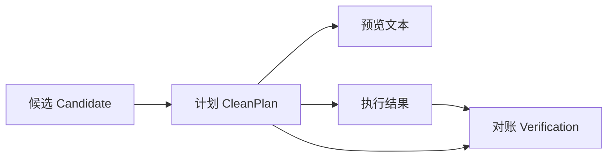

# 上下文与记忆架构

## 1. 四层分离

"Agent 记得什么"是模糊说法。拆成四层后，每层有明确的写入方和生命周期：

| 层 | 存储位置 | 写入方 | 生命周期 | 本项目是否实现 |
|----|---------|--------|---------|--------------|
| 会话状态 | 内存 `SessionState` | Agent | 单次会话 | ✅ |
| 任务状态 | 内存 `CleanPlan` | Agent | 一次清理 | ✅ |
| 执行历史 | `~/.disk_doctor/audit.jsonl` | Agent | 永久（可删） | ✅ |
| 用户画像 | 宿主注入 | **平台，不是 Agent** | 跨会话 | ❌ 不实现 |

第四层是关键。研究发现里有一条：专家"记得"用户磁盘紧张，但那个信息来自宿主注入，
不是它自己扫描的。行为上看不出区别，架构上完全是两回事。

本项目选择**不实现跨会话记忆**。理由：

1. 需要持久化用户的目录结构，属于隐私敏感数据
2. 收益有限：磁盘状态变化快，上周的记忆今天基本没用
3. 实现成本不低：需要清理策略、过期策略、冲突合并

不做，比做错好。

## 2. 会话状态

```python
@dataclass
class SessionState:
    session_id: str
    slots: dict[str, str]          # 目标范围等
    vetoes: dict[str, str]         # 用户否决过的路径
    plans: dict[str, CleanPlan]    # 已生成的计划
    confirmed_plan_ids: set[str]   # 已确认的计划 id
    history: list[Event]           # 事件流
```

三个字段值得单独说：

### 2.1 `slots` —— 槽位而非自由文本

只存"目标范围"这类跨轮次需要的信息。不存用户的整句话。

原因：整句保存会导致下一轮把上一轮的语境当成当前语境。用户先说"清 D 盘"、后说"看看 C 盘"，
如果存整句，很容易在两次之间混用范围。

### 2.2 `vetoes` —— 否决台账

用户说"这个大文件别删"，如果只记在对话历史里，几轮之后就可能被忘掉。
本项目的做法是显式记账：

```python
agent.veto(r"D:\work\build", "还要用")
```

之后每次生成计划都会过滤掉它：

```python
candidates = [c for c in candidates if key(c) not in vetoed_keys]
```

测试 `test_veto_keeps_item_out_of_later_plans` 验证了这条链路。

### 2.3 `confirmed_plan_ids` —— 确认绑定到计划

最重要的一个字段。存集合而不是布尔值，效果是：**计划变了，确认自动失效。**

```python
first  = agent.handle("清理", scope=root)   # plan_id = abc
agent.context.mark_confirmed("abc")
second = agent.handle("清理", scope=root)   # plan_id = def
assert not agent.context.is_confirmed("def")   # 自动失效
```

这条规则对应的正是"旧确认不能复用于新计划"——Agent 工具里最典型的越权删除成因。

## 3. 任务状态：CleanPlan 作为唯一载体



箭头全部从 `CleanPlan` 出发。报告、执行、对账读的是同一个对象，
所以不会出现"预览说 8.3 GB、报告说 7.8 GB"这种自相矛盾——它们根本没机会各算各的。

## 4. 执行历史

审计日志是 JSONL，每行一条事件：

```json
{"ts":"2026-11-05T09:12:31+00:00","event":"plan_start","plan_id":"644ac6dde75b","items":2,"requested_bytes":6815744,"dry_run":false}
{"ts":"2026-11-05T09:12:31+00:00","event":"item_move_begin","item_id":"I001","path":"...","bytes":6291456}
{"ts":"2026-11-05T09:12:31+00:00","event":"item_moved","item_id":"I001","path":"...","bytes":6291456}
```

三个设计取舍：

| 取舍 | 原因 |
|------|------|
| 移动**前后**各写一条 | 崩溃时能看到"打算做什么"和"做完了没" |
| 不记录文件内容 | 只记路径与字节数，避免日志本身变成隐私泄露 |
| 不自动轮转 | 由用户自己管理；静默删除日志会破坏可追溯性 |

## 5. 上下文冲突的处理

| 冲突 | 处理 |
|------|------|
| 前后范围不同 | 以最新的显式参数为准，槽位覆盖 |
| 用户否决了又在别处提到 | 否决优先，计划里过滤，并提示"此前已排除" |
| 计划变更后旧确认存在 | 自动失效（集合机制） |
| 会话内的旧计划 | 保留在 `plans` 里可查，但不会被复用执行 |

最后一条：旧计划不删，因为审计需要；但执行路径只接受当前 `plan_id`。

## 6. 记忆的边界

| 记住 | 不记住 |
|------|--------|
| 本次会话的授权范围 | 上次会话的授权范围 |
| 用户否决过哪些路径 | 用户上次否决过哪些路径 |
| 已生成的计划与确认状态 | 用户的目录结构 |
| 累计释放字节数 | 具体文件名历史 |

累计统计是唯一的跨会话数据，且只存聚合值（字节数、次数、解锁项），不存路径。
这是一个刻意的隐私边界。
