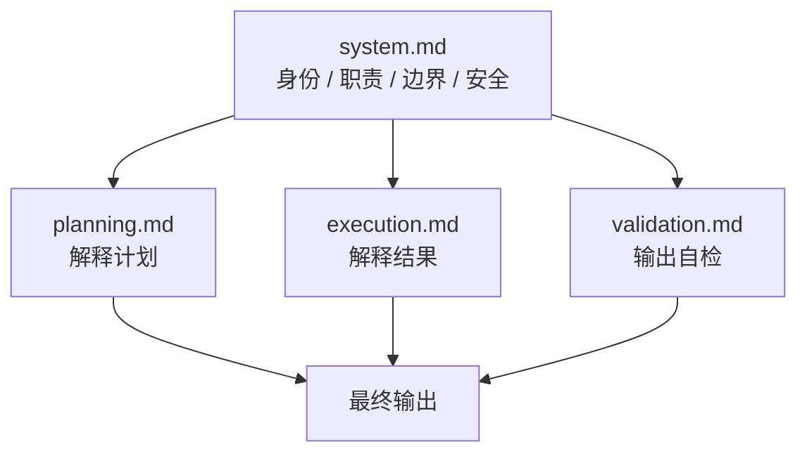

# 提示词架构

> 声明：本目录下的提示词是**独立编写的**，用于本参考实现。
> 它们不是、也不代表任何商业 Expert 的原始隐藏提示词。
> 研究只能观察到"输出长什么样"，无法观察"输入写了什么"。

---

## 1. 为什么提示词不是这个项目的主体

一个反直觉的结论：**在这个架构里，提示词是可选层。**

| 能力 | 由什么保证 | 提示词能否替代 |
|------|-----------|--------------|
| 不删授权范围外的路径 | `PolicyEngine` | ❌ |
| 执行前必须确认 | `SafeExecutor` 参数 | ❌ |
| 回收站不可用即停止 | `TrashManager` | ❌ |
| 数字来自实测 | `Validator` | ❌ |
| 报告措辞清楚 | 提示词 | ✅ |

表格前四行是安全属性，第五行是表达质量。提示词只能影响第五行。

**这是本项目与"提示词工程"路线的核心分歧。** 把安全规则写进提示词，等价于把门锁画在门上。

---

## 2. 分层设计



四层，`system` 是共同前缀，其余三个按阶段调用。

| 层 | 文件 | 何时调用 | 输入 | 输出 |
|----|------|---------|------|------|
| Identity / Role / Domain / Safety | `system.md` | 每次 | — | 行为约束 |
| Planning | `planning.md` | 生成预览后 | `CleanPlan` JSON | ≤150 字说明 |
| Execution | `execution.md` | 执行结束后 | `ExecutionResult` + `Verification` | 结果说明 |
| Validation | `validation.md` | 出报告前 | 待输出文本 | 8 项自检 |

---

## 3. 各层约束

### system.md

约束按"违反后果"排序，而不是按逻辑顺序：

1. 领域收窄（只做磁盘）
2. 不越权（删除必须确认）
3. 不猜测（未测数字标估算）
4. 不美化（失败要说失败）
5. 拒绝要给替代路径

第 5 条放在最后但很重要：只拒绝不给出路，用户会自己去搜更危险的做法。

### planning.md

四条硬约束，全部是为了防止模型"帮忙帮过头"：

- 不得修改数值
- 不得新增条目
- 不得改变风险等级
- 不得省略被拦截项

第三条尤其关键：模型很容易把 `caution` 描述成"完全安全"，因为这样读起来更顺。

### execution.md

核心是**区分估算与实测**：

```
observed_bytes 是实测，requested_bytes 是估算。措辞必须区分。
```

以及一条容易被忽略的：`mode == "dry_run"` 时禁止使用"已清理"。

演练模式下说"已清理"，是整个系统里最容易产生的一种误导——用户会以为空间已经释放了。

### validation.md

8 项自检清单。它**不能替代** `Validator`：

| 检查 | 谁做 |
|------|------|
| 数字对不对（计划 vs 实际） | `Validator`（代码） |
| 措辞有没有把估算说成实测 | 提示词 |
| 失败项有没有漏写 | 提示词 |
| 被拦截项有没有交代 | 提示词 |

分工原则：**能计算的不交给模型，能措辞的不写成代码。**

---

## 4. 提示词与代码的接口

模型永远不接收工具句柄。接口只有一个方法：

```python
def complete(self, system: str, user: str) -> str
```

调用点只有一处：

```python
def _narrate(self, turn: AgentTurn, user_text: str) -> str:
    comment = self.llm.complete(system=..., user=f"...{turn.message}")
    return turn.message + f"\n\n🤖 说明（{self.llm.name}）：{comment}"
```

注意返回值的构造方式：`turn.message + 追加`。模型输出**不可能覆盖**已渲染的事实部分。
即使模型完全跑偏，用户看到的仍然是正确的数字。

---

## 5. Mock 模式的意义

没有 API Key 时使用 `MockLLM`，输出格式：

```
[mock:a1b2c3d4] 已根据结构化结果生成说明。用户诉求要点：清理。以上文字由本地确定性模板产生，未调用任何模型服务。
```

三点设计：

1. **带 `[mock:` 前缀** —— 任何人都不会误认成真实模型输出
2. **确定性** —— 同样的输入产生同样的输出，测试可以断言
3. **明说未调用** —— 最后一句是给读日志的人看的

这不是"降级方案"，是**让整个系统可以在无网络、无密钥、无成本的情况下被完整验证**。

---

## 6. 换服务商

```bash
# 默认：DeepSeek
export DISK_DOCTOR_API_KEY=sk-...
python -m disk_doctor --provider openai diagnose

# 任意兼容 OpenAI 协议的服务
export DISK_DOCTOR_BASE_URL=https://your-endpoint/v1
export DISK_DOCTOR_MODEL=your-model
```

读取顺序：`DISK_DOCTOR_API_KEY` → `DEEPSEEK_API_KEY` → `OPENAI_API_KEY`。

密钥永不写入代码，也不写入日志。`.env.example` 只有占位符。

---

## 7. 如果提示词写错了会怎样

这是检验架构是否真的解耦的最好方式。

| 提示词错误 | 后果 | 系统是否仍然安全 |
|-----------|------|----------------|
| 写成"可以直接删除" | 报告措辞误导 | ✅ 仍受 `SafeExecutor` 约束 |
| 忘记"必须确认" | 模型可能建议跳过确认 | ✅ 代码层仍要求完整 plan_id + 一次性凭证 |
| 声称"已清理"（演练模式） | 用户误解 | ⚠️ 信息误导，但不产生实际损害 |
| 编造数字 | 报告失真 | ⚠️ 事实部分仍在，但可信度受损 |

前两行安全，后两行是质量问题。这个分界正是本项目想要的：**提示词出错最多影响表达，不会影响磁盘。**
