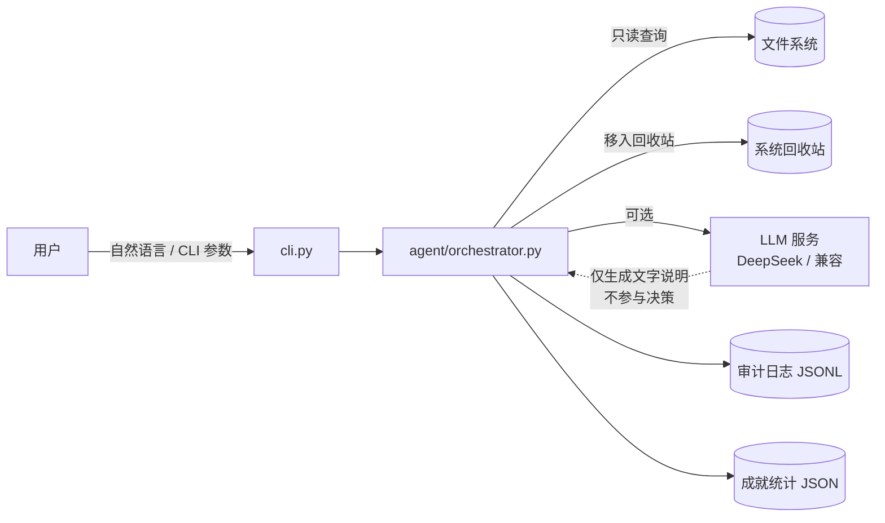
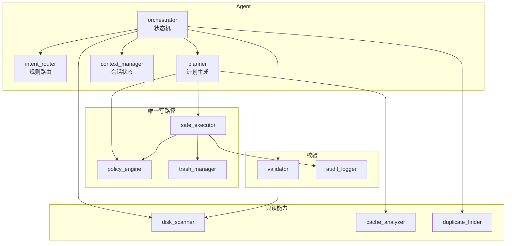
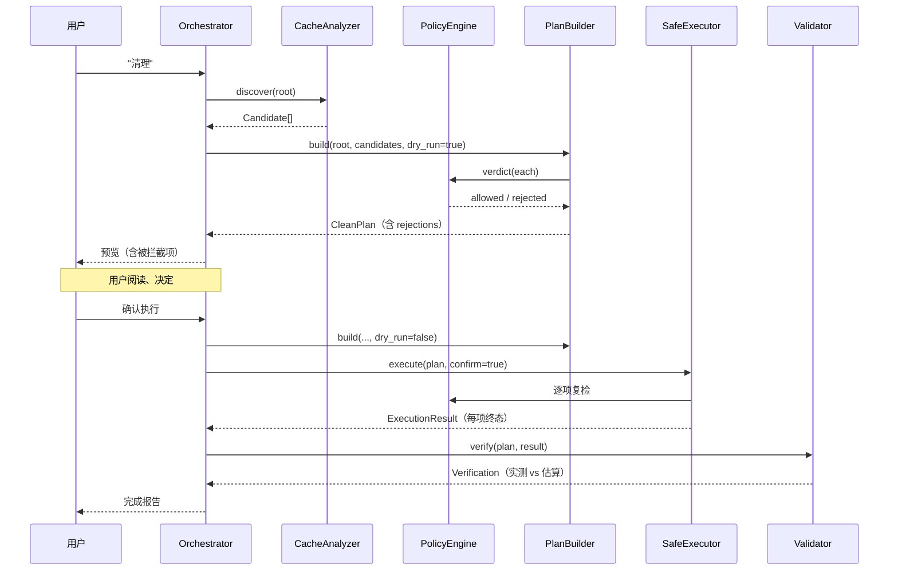

# 系统架构

## 1. System Context



三条边界值得注意：

- 模型是**旁路**，不在主链路上。没有它，整个 Agent 仍然完整可用。
- 唯一的写操作通向回收站，没有第二条路。
- 审计日志与成就统计都在用户目录下，不写系统位置。

## 2. Component View



`policy_engine` 出现两次：一次在计划阶段（过滤候选），一次在执行阶段（逐项复检）。
这不是冗余。计划生成到执行之间可能隔着用户阅读的几分钟到几个小时，期间文件系统会变。

## 3. 数据流



**关键点：`CleanPlan` 是唯一在阶段之间传递的对象。** 所有数字从它读，不重算。
这样报告里的"预计释放 8.3 GB"和实际执行的字节数必然同源，不会出现自相矛盾。

## 4. 模块职责表

| 模块 | 职责 | 不做的事 |
|------|------|---------|
| `cli.py` | 参数解析、退出码、安全标志 | 不做业务判断 |
| `agent/intent_router.py` | 文本 → 意图 + 范围 | 不决定是否执行 |
| `agent/planner.py` | 候选 → CleanPlan | 不写盘 |
| `agent/context_manager.py` | 会话状态、否决台账 | 不做持久化 |
| `agent/orchestrator.py` | 状态机、分支调度 | 不直接碰文件 |
| `core/policy_engine.py` | 路径白名单裁决 | 不执行 |
| `core/clean_plan.py` | 过滤、去重、排序、截断 | 不测量 |
| `core/safe_executor.py` | 唯一写入口 | 不做策略判断（交给 policy） |
| `core/validator.py` | 计划 vs 实际对账 | 不修改任何东西 |
| `tools/*` | 具体测量与识别 | 不删除 |
| `reporting/*` | 渲染文本 | 不计算数字 |

"不做的事"这一列比"职责"更重要。它划出的是可审查的边界。

## 5. 依赖方向

```
cli  →  agent  →  core  →  (stdlib)
                →  tools →  core
                →  reporting → core
                →  llm
```

单向，无环。`core` 不依赖 `agent`，所以核心逻辑可以脱离 Agent 单独测试——93 个测试里有 45 个就是这么测的。

## 6. 部署形态

| 形态 | 启动方式 | 适用 |
|------|---------|------|
| CLI 单次 | `disk-doctor clean ...` | 脚本、定时任务 |
| CLI 交互式 | `disk-doctor ask "..."` | 人工使用 |
| 库调用 | `DiskDoctorAgent.create(...)` | 嵌入其他系统 |
| CI 演示 | `--provider mock --quarantine DIR` | 无网络、无回收站环境 |

四种形态共用同一套内核，区别只在入口，不在逻辑。
