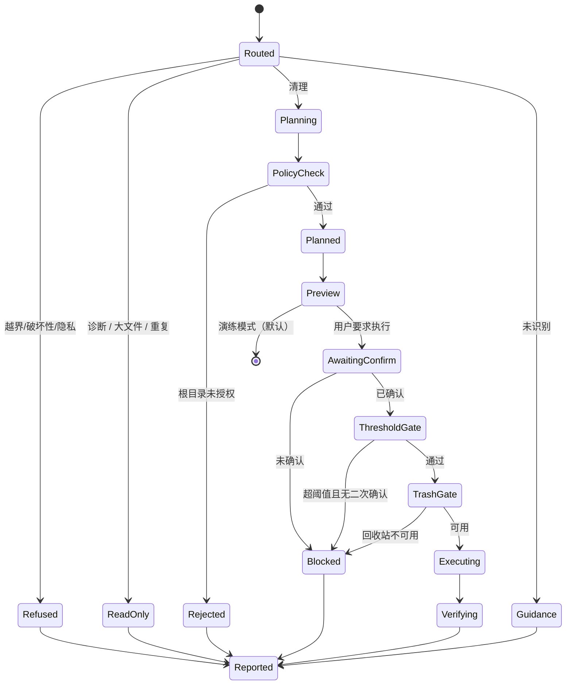

# 工作流

## 1. 状态机



**只有一条路径能到达 `Executing`**：已授权根目录 → 有确认 → 过阈值 → 回收站可用。四条任一不满足，都终止在 `Blocked` 或 `Rejected`。

## 2. 五步与代码的对应

产品自述的五步工作流（SELF-REPORTED）在本项目中的落地：

| 自述步骤 | 代码位置 | 与自述的差异 |
|---------|---------|------------|
| 问诊（了解需求） | `intent_router` + `context_manager.slots` | 只对"目标范围"追问；其余走默认并声明。避免连环追问 |
| 检查（扫描） | `disk_scanner` / `cache_analyzer` | 只读，先做再说。能用测量解决的不问用户 |
| 开方（展示方案） | `plan_builder` + `reporting.preview` | 额外输出被拦截项——自述里没有这一条 |
| 治疗（执行） | `safe_executor` | 多了"回收站不可用即停止"，自述里是"能进回收站就绝不永久删除"，语气更软 |
| 复查（报告） | `validator` + `reporting.completion` | 区分实测与估算；自述模板里两者混用 |

**最后一行是刻意偏离。** 自述的完成报告写"释放空间：7.8GB"，但没说是估算还是实测。本项目强制分成两行。

## 3. 一次清理的完整时序

```
用户：清理 D:\work\temp
  │
  ├─ 路由      → CLEAN_QUICK，scope=D:\work\temp
  ├─ 范围校验  → PolicyEngine.verdict(root) 必须 allow
  ├─ 候选发现  → CacheAnalyzer.discover（深度 ≤ 4，跳过符号链接）
  ├─ 计划构建  → 过滤 → 去重 → 按风险+体积排序 → 截断到 500 项
  ├─ 预览      → 渲染 items + rejections + 合计
  └─ 返回      → awaiting_confirmation = True，plan_id 已存入会话

用户：确认
  │
  ├─ 计划复用  → 从 PlanStore 取回同一 plan_id 的计划（不重新生成）
  ├─ 执行领取  → claim_for_execution：进程内锁 + 跨进程锁 + 写 IN_PROGRESS
  ├─ 确认校验  → verify_and_consume：签名/有效期/二次确认，并当场作废凭证
  ├─ 回收站    → is_available() 为假则整体阻断
  ├─ 逐项执行  → 复检 policy → 测量 → 移入回收站 → 记录
  ├─ 对账      → 重新检查路径是否真的不存在，扣除残留
  └─ 报告      → 实测释放 / 失败明细 / 可撤销说明 / 成就
```

**"计划复用"这一步是安全关键。** 如果确认后重新生成计划，用户批准的和实际执行的就是两个东西。

## 4. 分支处理

### 4.1 未识别意图

不猜。返回可选动作清单，让用户用一句话重新描述。

### 4.2 越界请求

三段式：拒绝什么 → 为什么 → 你可以怎么做。

```
❌ 无法执行：数据恢复不在能力范围内
   → 请立即停止对该磁盘的写入，然后使用专业恢复工具。继续扫描会降低恢复成功率。
```

注意第二句不是客套：误删之后继续读盘，确实会降低恢复成功率。这个提示本身是有价值的输出。

### 4.3 部分失败

不整体回滚，也不报"完成"。逐项记录终态，报告里分开写成功/跳过/失败。

理由：回滚需要把已移入回收站的文件再拖回来，而拖回的过程本身也可能失败。相比之下，"部分完成 + 明细"是更诚实也更安全的结果。

## 5. 不做的事

| 不实现 | 原因 |
|--------|------|
| 自动重试失败的删除 | 删除不是幂等操作，重试可能造成重复副作用 |
| 后台常驻监控 | 需要系统权限，且与本项目的"用户主动触发"定位冲突 |
| 自动清理（无确认） | 违反核心约束，即使配置也不开放 |
| 跨会话记忆用户目录 | 属于隐私敏感数据，收益不足 |

## 6. 可测试性设计

工作流能被测试，是因为状态转移不依赖时间、网络或模型：

- 路由：纯函数，输入字符串、输出枚举
- 计划：输入候选列表、输出数据对象
- 执行：注入 `TrashBackend`，测试用 `QuarantineBackend`
- 校验：输入计划与结果、输出对账

唯一需要真实文件系统的是测量部分，而它只在 `tmp_path` 内运行。
